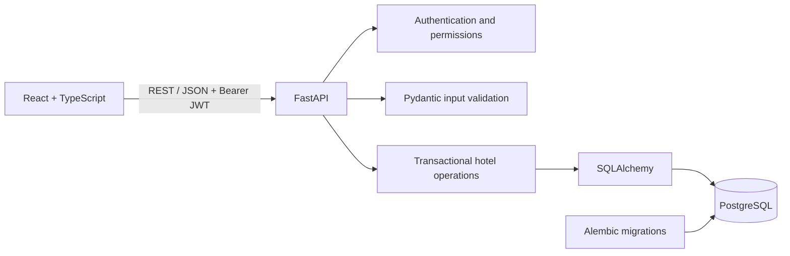
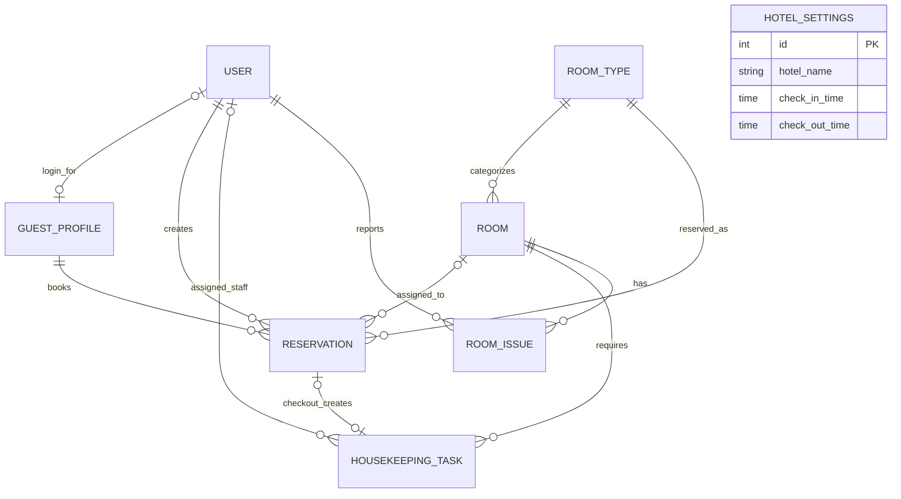
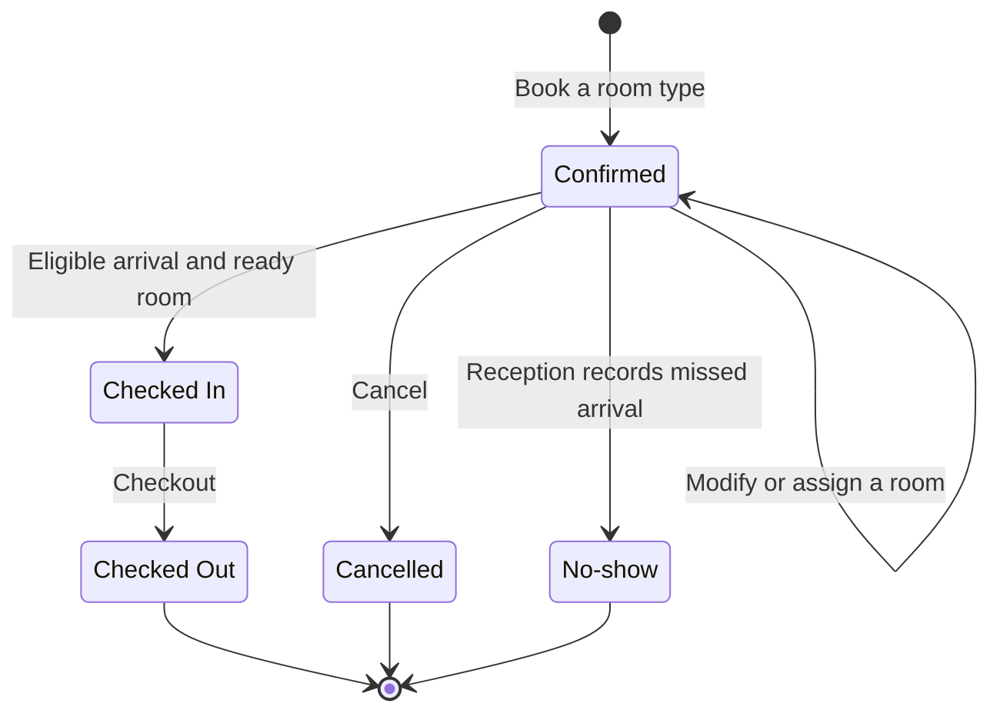
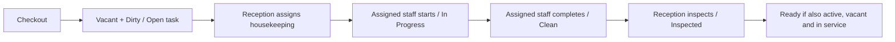

# Architecture, database and hotel workflows

See the [project README](../README.md) for installation, environment variables, demo accounts, and test commands.

## System architecture

Haven manages one hotel. A React and TypeScript single-page application calls a FastAPI REST API. SQLAlchemy maps the hotel entities to PostgreSQL, and Alembic manages schema changes and initial configuration.



The browser sends requests to `/api`. In local development and preview, Vite proxies these requests to `http://127.0.0.1:8000`. The backend owns permission checks, availability calculations, prices, and state transitions. Frontend controls reflect these rules for the user.

## Code organization

| Area | Responsibility |
| --- | --- |
| [App.tsx](../frontend/src/App.tsx) and [context.tsx](../frontend/src/context.tsx) | Login state, hotel settings, navigation, role-specific routes, notifications, and refresh coordination |
| [api.ts](../frontend/src/api.ts) | JSON requests, bearer tokens, API error messages, and expired-session handling |
| Frontend pages | Dashboard, booking, reservations, rooms, housekeeping, issues, and administration |
| [ui.tsx](../frontend/src/ui.tsx), [types.ts](../frontend/src/types.ts), and [styles.css](../frontend/src/styles.css) | Shared components, request loading state, response types, and responsive styling |
| [main.py](../backend/app/main.py) | HTTP endpoints, role dependencies, database queries, configuration changes, and housekeeping/issue actions |
| [services.py](../backend/app/services.py) | Inventory checks, room assignment, reservation changes, check-in/out, and shared operational guards |
| [schemas.py](../backend/app/schemas.py) and [presenters.py](../backend/app/presenters.py) | Validated request bodies and explicit response projections |
| [security.py](../backend/app/security.py) | Password hashing, JWT issuance and verification, active-account checks, and role dependencies |
| [models.py](../backend/app/models.py) and [db.py](../backend/app/db.py) | Entities, database constraints, sessions, commit, and rollback |
| [alembic](../backend/alembic) | Versioned schema and initial hotel configuration |

React context shares the current user, hotel settings, a refresh version, and notifications. Page-level hooks reload data after a successful mutation. Hotel time is refreshed every 30 seconds; eligibility is always checked again by the API.

## Database ERD

The diagram shows all eight entities. A reservation chooses a room type before a physical room is assigned. Guest profiles created by reception can exist without login accounts.



| Entity | Stored information and constraints |
| --- | --- |
| `User` | Unique email, name, password hash, role, active status, and token version |
| `GuestProfile` | Contact details and an optional unique link to a user |
| `HotelSettings` | One row with `id = 1`; checkout time must precede check-in time |
| `RoomType` | Unique name, positive capacity, positive nightly rate, and active status |
| `Room` | Unique room number, type, floor, notes, active status, and three independent status dimensions |
| `Reservation` | Guest, creator, room type, optional room assignment, dates, guest count, price snapshot, lifecycle state, and event timestamps |
| `HousekeepingTask` | Room, optional unique checkout reservation, optional assigned staff, priority, notes, and work timestamps |
| `RoomIssue` | Room, reporting user, description, open/resolved state, and timestamps |

Foreign keys preserve the relationships. Check constraints restrict allowed states and positive capacities/costs. Reservation totals must equal the saved nightly rate multiplied by the number of nights. Money uses fixed-precision decimal columns; the application currency is SAR.

## Reservations and availability

Stays occupy half-open date intervals: `[check-in, check-out)`. A checkout and a new arrival on the same date do not overlap. Stays must be 1–365 nights, cannot begin in the past, and must fit the selected room type's capacity.

Availability counts active, in-service physical rooms of a type and subtracts the peak nightly consumption by `Confirmed` and `Checked In` reservations over the requested stay. Dirty and clean rooms still contribute to future inventory; readiness is enforced separately at check-in. An availability search is informational, and booking revalidates inventory inside the write transaction.



- A reservation holds one room for its entire stay. Guest count does not distinguish adults and children.
- Booking snapshots the current nightly price and total. Later room-type price edits preserve existing bookings; explicitly modifying a reservation recalculates its price at the current rate.
- Only confirmed reservations can be changed or cancelled. Guests can act only on their own reservations and only before the scheduled check-in instant. Reception and admin can cancel any still-confirmed reservation.
- Changing dates or room type clears the physical assignment. Changing guest count alone retains it. Failed validation rolls back the change.
- Assigned rooms must match the booked type, be active and in service, and have no overlapping active assignment. A future reservation can use a currently occupied or dirty room if the booking dates do not conflict.
- Check-in requires the scheduled arrival date, the configured check-in time to have passed, and an assigned room that is active, vacant, inspected, and in service.
- No-show is a manual reception/admin action available from the scheduled arrival instant. There is no automatic no-show job.
- A walk-in creates the booking, assigns a room, and checks in within one transaction. It uses the same capacity, date, time, and readiness rules.
- Checkout can record an early or delayed actual departure. It does not extend the reserved date interval or calculate additional charges.

## Room readiness and housekeeping

| Dimension | Values |
| --- | --- |
| Occupancy | `Vacant`, `Occupied` |
| Housekeeping | `Dirty`, `Clean`, `Inspected` |
| Operational | `In Service`, `Out of Order` |



Checkout changes the reservation to `Checked Out`, marks the room vacant and dirty, and creates one open housekeeping task atomically. The task has high priority when another confirmed reservation is assigned to that room for the same day.

Reception/admin assign or reassign open tasks to active housekeepers. Only the assigned housekeeper can start and complete a task, and the room must be vacant. Completing work records notes and marks the room `Clean`. Reception/admin inspect it in a separate action; cleaning completion never automatically marks it `Inspected`.

Housekeepers can report issues for rooms in their assigned task history and view their own reports. Reception/admin view all reports and resolve them. Reporting or resolving an issue does not change the room's operational status automatically.

Taking a room out of service is refused while it is occupied, has an active physical assignment, or would leave existing reservations without enough inventory. Deactivating an in-service room uses the same guard; deactivation also requires outstanding housekeeping work to finish. Room type cannot be changed after a physical room is created.

## Atomicity and concurrency

Inventory and operational writers first lock the singleton `HotelSettings` row with PostgreSQL `SELECT ... FOR UPDATE`. The shared lock serializes reservation, room, housekeeping, and relevant configuration changes across workers. It remains held through validation, updates, and commit. This favors straightforward consistency for one hotel and limits concurrent write throughput.

The request's database dependency commits successful work and rolls back exceptions. Walk-in and checkout operations therefore cannot leave partially applied reservation, room, or task changes.

PostgreSQL also enforces `no_overlapping_room_assignment`, a GiST exclusion constraint over the assigned room and half-open stay range for confirmed/checked-in reservations. It requires `btree_gist`, enabled by the migration. A unique reservation reference on housekeeping tasks prevents duplicate checkout tasks.

SQLite is used for convenient local tests. It does not provide the PostgreSQL row-lock or exclusion-constraint guarantees; concurrent booking behavior must be checked against PostgreSQL.

## Authentication and permissions

Passwords are hashed with Argon2. JWTs are signed with HS256 and include a user ID, issuer, audience, expiration, and token version. Protected requests verify the token and reload the user's active status and version from the database.

The browser keeps the access token in `sessionStorage` and sends it as `Authorization: Bearer ...`. Tokens expire after 120 minutes by default. Logout increments the account's token version and invalidates all its outstanding tokens. A disabled account cannot authenticate.

| Role | Authorized operations |
| --- | --- |
| Admin | Hotel settings, room types/prices, rooms, receptionist/housekeeping accounts, and all front-desk operations |
| Receptionist | Guests, reservations, walk-ins, room assignment, check-in/out, manual no-shows, housekeeping coordination, inspection, and room issues |
| Housekeeping | View assigned tasks, start/complete their own work, report relevant room issues, and view their own reports |
| Guest | Own profile and reservations, availability, booking, and eligible self-service changes/cancellation |

Frontend routes and controls follow the current role; backend dependencies and ownership checks enforce access. Reception/admin cannot complete cleaning on behalf of a housekeeper, and housekeeping cannot inspect rooms or operate reservations.

Guest registration creates a linked profile. Reception-created profiles do not create login accounts, and matching email addresses never automatically merge profiles. The staff UI creates only receptionist/housekeeping accounts and edits name/active status. Initial admin creation uses the `app.create_admin` CLI. A housekeeper's open tasks must be reassigned and in-progress work completed before their account can be disabled.

## Time, initialization, and history

`HOTEL_TIMEZONE` defaults to `Asia/Riyadh`. Arrival dates, check-in cutoffs, no-shows, and dashboard dates use hotel-local time. Event timestamps are recorded in UTC. Standard check-in and checkout times belong to `HotelSettings`.

Alembic's first revision creates the schema. Revision `002` adds the hotel settings, four initial room types, and PostgreSQL overlap protection. Rooms and accounts are then added through administration or the explicit demo seed. The demo seed refuses to overwrite an existing hotel.

Revision `002` retains operational data on downgrade and initializes only empty configuration tables on upgrade. Reapplying it preserves edited hotel settings, renamed room types, prices, and existing reservations. Exercise schema rollbacks only in disposable test databases.

Reservations and completed work remain in history; there are no destructive delete endpoints. Rooms and room types are deactivated when no longer offered. Reservation prices are saved snapshots, while related guest and room-type descriptions are read from their current records.

## Project structure

```text
hotel-management/
├── backend/
│   ├── app/
│   │   ├── main.py          # API routes and permissions
│   │   ├── services.py      # Reservation and inventory operations
│   │   ├── models.py        # Entities and database constraints
│   │   ├── schemas.py       # Request validation
│   │   ├── presenters.py    # Response projections
│   │   ├── security.py      # Passwords, JWTs, roles
│   │   ├── db.py            # Sessions and transactions
│   │   ├── config.py        # Environment settings
│   │   ├── seed.py          # Optional demo data
│   │   └── create_admin.py  # Initial admin account
│   ├── alembic/             # Versioned migrations
│   ├── tests/               # API and business-rule tests
│   ├── .env.example         # Backend configuration template
│   ├── requirements.txt
│   └── requirements.lock.txt
├── frontend/
│   ├── src/
│   │   ├── main.tsx         # React entry point
│   │   ├── App.tsx          # Session, navigation, and routes
│   │   ├── Dashboard.tsx    # Role-specific dashboards
│   │   ├── Booking.tsx      # Booking, editing, walk-ins
│   │   ├── Reservations.tsx # Reservation lists and actions
│   │   ├── Operations.tsx   # Rooms, housekeeping, issues
│   │   ├── Admin.tsx        # Configuration, staff, profile
│   │   ├── api.ts           # API client and token handling
│   │   ├── context.tsx      # Shared session and refresh state
│   │   ├── ui.tsx           # Shared components and hooks
│   │   ├── types.ts         # Response types
│   │   └── styles.css       # Responsive styling
│   ├── package.json
│   ├── package-lock.json
│   └── vite.config.ts       # React/Tailwind plugins and API proxy
├── docs/
│   ├── ARCHITECTURE.md
│   └── screenshots/
├── .gitignore
└── README.md
```
